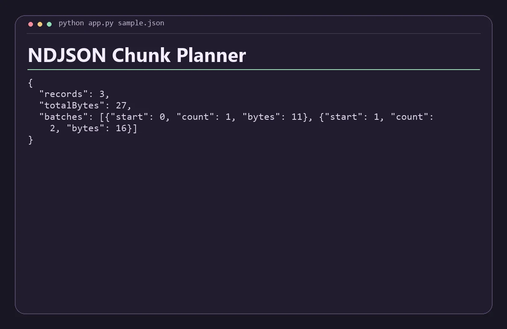

# NDJSON Chunk Planner

Plan ordered newline-delimited JSON batches that fit an exact UTF-8 byte budget.



## Run

Install Python 3.11 or newer. Run these commands from the repository root.

```sh
python app.py sample.json
```

Replace `sample.json` with a JSON file following the same structure. The app prints a JSON report to standard output.

The planner serializes records as compact JSON with a trailing newline and packs consecutive records greedily. Start indices are zero-based. A record larger than the byte limit is rejected. The tool reports boundaries and never rewrites the original file.

## Verify

Run `python check.py` with Python 3.11 or newer after the build step when applicable. The check verifies the bundled scenario and confirms that an invalid input returns an error.
